  

  

  
  

---

**Head of AI Research.** I work across the full model lifecycle: **training foundation models** and making them
**run fast on GPUs**.

On GitHub I publish **measured** work on training models efficiently and squeezing performance out of GPUs.
Every repo ships with a benchmark script, the hardware it ran on, and the raw numbers.

### 🔬 What I'm building

| Repo | What it does | Status |
|---|---|---|
| [**quantbench**](https://github.com/ramkumar-mv/quantbench) | Reproducible LLM quantization benchmarks (FP16 / INT8 / INT4 AWQ·GPTQ / FP8 / NVFP4): latency, throughput, memory and quality loss in one harness | 🚧 active |
| **pretrain-16gb** | Pretraining a small GPT from scratch on one 16 GB GPU, with an ablation of every speed trick (bf16/FP8, FlashAttention, torch.compile, fused optimizers) measured in tokens/s and MFU | 📋 planned |
| **finetune-lab** | SFT, LoRA / QLoRA / DoRA and DPO / GRPO compared head-to-head on public data: VRAM, step time and eval quality | 📋 planned |
| **blackwell-kernels** | Hand-written Triton kernels (fused dequant-GEMM, FP8 GEMM, RMSNorm+quant) benchmarked against cuBLAS and PyTorch | 📋 planned |

### 🧠 Model training

| | |
|---|---|
| 🏗️ **Pretraining** | data pipelines, tokenizers, scaling small LMs, training stability |
| 🎛️ **Fine-tuning** | full SFT, LoRA / QLoRA / DoRA, instruction tuning |
| 🎯 **Alignment** | DPO, ORPO, GRPO / RL-style post-training |
| 🌐 **Distributed & memory** | FSDP / DeepSpeed ZeRO, gradient checkpointing, mixed precision (bf16 / FP8), 8-bit optimizers |

### ⚡ GPU optimization

| | |
|---|---|
| 🧩 **Kernels** | custom Triton / CUDA kernels, FlashAttention, kernel fusion, torch.compile |
| 🗜️ **Quantization** | INT8 / INT4 (AWQ, GPTQ, GGUF), FP8, NVFP4 |
| 🚀 **Inference serving** | vLLM, TensorRT-LLM, Triton Inference Server, KV-cache tricks, speculative decoding, batching |
| 🔍 **Profiling** | Nsight Systems / Compute, roofline analysis, MFU and memory-bandwidth accounting |

### 🛠️ Stack

  

`Triton` · `CUDA` · `DeepSpeed` · `FSDP` · `HF Transformers / PEFT / TRL` · `vLLM` · `TensorRT-LLM` · `llama.cpp`

### 🧭 Background
- B.Tech, E.C.E., SRM Institute of Science and Technology (CGPA 9.58/10)
- AI/ML Associate, IIT Madras · ML Intern, MITACS Globalink (Toronto) · Global Academic Intern, NUS (Singapore)

### 📐 Principles
- **No table, no claim:** pinned deps, scripts, hardware, raw numbers
- Report quality loss next to every speedup
- Built only on public models and public data
- All experiments run on my own personal workstation (RTX 5070 Ti 16 GB)
